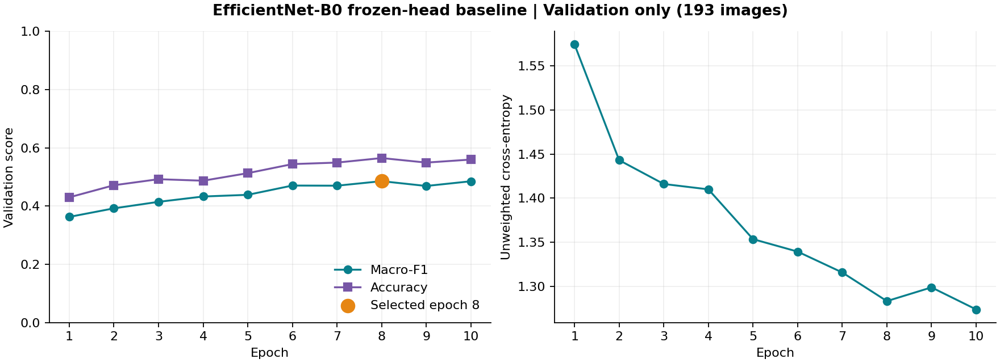
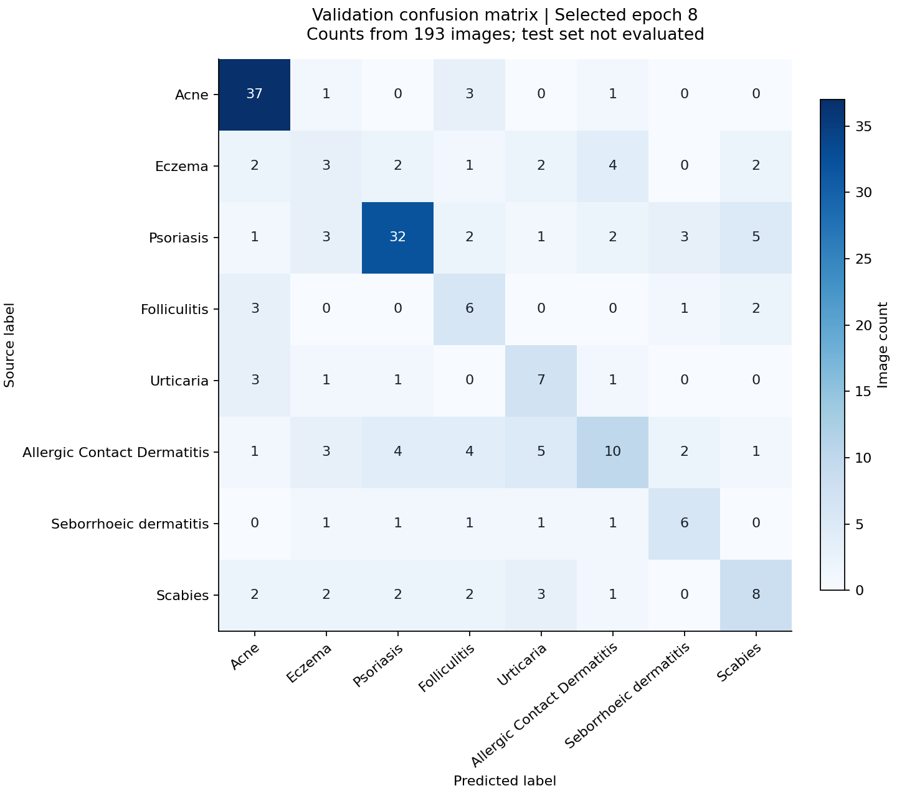

# EfficientNet-B0 frozen-head baseline results

Completed 18 October 2026. The first full baseline ran for the planned 10 epochs on the local RTX 4060 GPU. The best validation checkpoint was saved at **epoch 8**, following the predeclared macro-F1 selection rule.

## Main result — validation only

| Measure | Result |
|---|---:|
| Training images |1,374|
| Validation images |193|
| Test images evaluated |0|
| Best epoch |8 of 10|
| Validation accuracy |56.48% (109/193)|
| Validation macro-F1 |0.4855|
| Validation unweighted cross-entropy |1.2832|

The ImageNet feature extractor stayed frozen. Only the new eight-class output layer trained; no feature-block fine-tuning or augmentation occurred. The run retained the frozen `eight-class-v1` split, seed 3403, batch 16 and all other recorded [baseline settings](../../ai/baseline_config.json).



Epoch 1 macro-F1 was 0.3629; the selected epoch 8 reached 0.4855. Epoch 10 had slightly lower macro-F1 (0.4852), despite lower validation loss (1.2738), so epoch 8 remains selected. This is one initial 10-epoch, single-seed baseline, not evidence of an optimal/converged model or stable performance across seeds. Recorded epoch work totalled 205.14 seconds, excluding setup/startup and later verification.

## Per-class validation results

| Inherited source class | Images | Precision | Recall | F1 |
|---|---:|---:|---:|---:|
| Acne |42|0.7551|0.8810|0.8132|
| Eczema |16|0.2143|0.1875|0.2000|
| Psoriasis |49|0.7619|0.6531|0.7033|
| Folliculitis |12|0.3158|0.5000|0.3871|
| Urticaria |13|0.3684|0.5385|0.4375|
| Allergic contact dermatitis |30|0.5000|0.3333|0.4000|
| Seborrhoeic dermatitis |11|0.5000|0.5455|0.5217|
| Scabies |20|0.4444|0.4000|0.4211|

These are comparisons against inherited dataset labels, not independent clinical diagnoses. Eczema was weakest: 3 of 16 validation images were assigned its source label. Acne and psoriasis performed better in this run. Some classes have only 11–16 validation images, so individual errors materially change their scores. No claim about real phone photos, patient-independent generalisation or diagnostic safety follows from this result.



Larger off-diagonal counts include 5 psoriasis images predicted as scabies, 5 allergic-contact-dermatitis images predicted as urticaria, and 4 eczema images predicted as allergic contact dermatitis. These are observations for validation-based model development, not reasons to relabel source images or change the test set.

## Saved artifacts and verification

- Local model: `ai/runs/efficientnet-b0-baseline-v1/best.pt` (ignored by Git).
- Checkpoint SHA-256: `c13595ca48d53e69ecf83feec287920494285c10c1d273b590ab7ba289e41d1c`.
- Original run configuration/environment, ten-epoch history and completion marker remain in the same ignored run folder.
- Tracked [summary](baseline_results/summary.json), [epoch aggregates](baseline_results/epochs.json), [per-class CSV](baseline_results/per_class.csv), learning curve and confusion matrix preserve reviewable results without copying source photos or model binaries into Git.

The training command exited successfully and wrote its 10-epoch completion marker. A separate verifier loaded the saved checkpoint using `weights_only=True`, checked its metadata/epoch against the logged selection rule and replayed all 193 validation images. Accuracy, macro-F1, per-class metrics and confusion counts matched exactly; validation loss matched within the configured numerical tolerance. It also compared the entire saved feature state—including BatchNorm buffers—with the original ImageNet state: unchanged. The classifier differed from its seeded initial state, confirming an actual training update. All frozen manifest locks and loaded image hashes were checked by the existing loaders. No test-image evaluation occurred.

Both figures were rendered with Matplotlib and visually inspected for readable labels and correct validation-only titles. Plot dependencies live only in ignored `tmp/baseline-plot-runtime`; neither the app nor training environment was modified for plotting. The pre-existing user edit to `docs/ai/BASELINE_SETUP.md` was preserved and is outside this checkpoint's changes. Word, app code, application predictions and running clinic services were unchanged; predictions in the app remain simulated.

## Reproduce analysis

With the completed run and original cached ImageNet weights present:

```powershell
.\.venv-ai\Scripts\python.exe ai/summarize_baseline.py --run-id efficientnet-b0-baseline-v1 --device cuda
.\.venv-ai\Scripts\python.exe -m pip install --target tmp/baseline-plot-runtime -r ai/requirements-report.txt
.\.venv-ai\Scripts\python.exe ai/plot_baseline.py
```

The verifier does not retrain or download weights. The plotter consumes aggregate results only. Re-running training requires a new run ID; it never overwrites this run. Checkpoint replay verification does not mean that a second complete training run was performed.

Next manageable task: fine-tune selected upper feature blocks from this saved baseline using a lower learning rate and training-only augmentation, while keeping the same validation criterion and frozen dataset. Compare against this baseline before choosing a final model. The 401-image test set remains reserved for final evaluation after model selection. No fine-tuned or deployable skin model is claimed yet.
