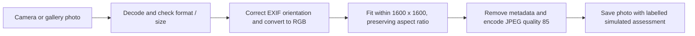
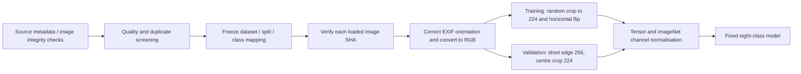

# Dataset readiness and image-processing flow

18 October 2026. Metadata-only scope review plus a separate fixed-checkpoint validation upload check. No class was removed, replaced or relabelled. No new training, image acquisition or Word editing in this task. Existing eight-class results remain historical evidence for that exact task.

## What image processing already exists

### Phone upload and storage

The pure backend helper `apps/api/app/photos.py` accepts readable JPEG/PNG/WebP up to 5 MiB, minimum 32 pixels per side, maximum 25 megapixels. These are file/size boundaries, not evidence that a photo is suitable for classification. Source photos are not colour-normalised with ImageNet means at storage time. The app still performs no trained inference; metadata stripping and correct orientation do not make a prediction clinically reliable.

### Offline model training and validation

Current matched experiments use bicubic interpolation and ImageNet means `(0.485, 0.456, 0.406)` / standard deviations `(0.229, 0.224, 0.225)`. Training crop scale is 0.85–1.0, aspect ratio 0.9–1.1, flip probability 0.5. Validation uses deterministic geometry without random augmentation. Class weighting addresses training-loss imbalance; it does not make sample counts equal or create independent cases.

Dataset preparation excluded 108 of 2,076 selected images, leaving 1,968 with a 1,374/193/401 split. Technical visual review is partial; inherited diagnosis labels are not independently clinically verified, and patient independence cannot be established from absent IDs. The final-test pixels remain reserved. An earlier controlled full-frame padding experiment did not beat its own centre-crop comparator; it did not compare against the newer full-feature B0 control and is not a general verdict on the best framing for phone photos.

## Remaining processing and reliability work

1. **Measure the upload transformation.** The backend recompresses/downsizes images, while training reads original dataset bytes. Run the actual helper on existing validation images, then compare fixed-checkpoint outputs using the exact model transform. Report rejections, prediction changes and per-class metrics; do not exclude failed uploads silently or train on the results. A validation compatibility check is not a real-camera study.
2. **Review input usability.** Blur, extreme exposure, distant framing, masks/text overlays, multiple affected regions and off-centre lesions need reviewed examples. Start with advisory flags and photo-retake guidance. Validate thresholds across cameras, skin tones and conditions before automatic rejection; a low texture/brightness score alone is not a valid diagnosis or universal quality rule.
3. **Keep training and inference preprocessing versioned together.** A future deployed checkpoint must declare its geometry, RGB conversion and channel normalisation. Use deterministic inference; augmentation remains training-only. Test off-centre framing and source-specific performance. Device compression before the backend also needs actual phone checks.
4. **Test unsupported inputs and uncertainty.** Current code has no validated skin detector, lesion segmenter, out-of-scope detector, confidence calibration or automatic abstention rule. These need suitable development examples and evaluation of both errors and coverage. Do not describe the current model as capable of rejecting arbitrary unknown diseases.
5. **Evaluate proposed enhancements independently.** Denoising, sharpening, colour/contrast correction, hair removal or segmentation are experimental changes, not proven fixes for these models. They may modify useful appearance cues. Use a bounded comparison and retain originals; do not alter validation until a higher score appears, apply unverified diagnostic relabelling or claim 85% in advance.

## Current disease/source readiness

The [reproducible census](dataset_readiness/summary.json) rechecks SHA-locked source metadata and frozen manifests. SCIN counts below use the already documented strict metadata screen, not confirmed diagnoses or training-ready images. Multiple views remain one case; most selected focus cases have only one available grader. Exact current class strings do not establish complete cross-source diagnostic equivalence.

| Condition | Frozen train / val | Strict SCIN candidate cases | Photos retained for further preparation | Current priority |
|---|---:|---:|---:|---|
| Acne | 287 / 42 | 14 | 0 | Retain as an anchor; complete quality review |
| Psoriasis | 356 / 49 | 17 | 0 | Retain as an anchor; complete quality review |
| Eczema | 118 / 16 | 121 | 18 | Priority label and source-expansion review |
| Folliculitis | 98 / 12 | 36 | 0 | Review case/label coverage before keeping final scope |
| Urticaria | 88 / 13 | 86 | 0 | Candidate for bounded SCIN photo review |
| Allergic contact dermatitis | 209 / 30 | 38 | 17 | Define cross-source label policy; no automatic eczema merge |
| Seborrhoeic dermatitis | 79 / 11 | 5 | 2 | First deferral candidate if adequate data remains unavailable |
| Scabies | 139 / 20 | 0 | 0 | Existing-source review; no strict SCIN expansion identified |

The 37 retained SCIN photos remain preparation candidates, with zero currently approved for extra training. Before merging sources, define case/duplicate grouping, label compatibility and a source-specific development holdout. Avoid making one source unique to a disease: the model could exploit photography/source differences rather than disease features. Keep per-source results visible. Dermnet remains pending source/use clarification and several of its folders mix diagnoses; no Dermnet images were acquired or used.

### Exploratory replacement census

These four source labels are metadata leads, not selected replacements or clinically endorsed scope. No photos have been acquired for them in this review. Counts preserve the corrected source's partitions, before our new quality/exclusion review; never move source test examples into training to enlarge a class.

| Corrected source label | Train | Validation | Test | Interpretation |
|---|---:|---:|---:|---|
| Lichen planus | 264 | 38 | 75 | Larger metadata pool; merits a label/image/use-case review |
| Pityriasis rosea | 86 | 12 | 25 | Modest pool; no automatic sample-size improvement |
| Vitiligo | 79 | 11 | 23 | Similar small pool; no performance evidence |
| Rosacea | 55 | 8 | 16 | Smaller pool; unsuitable as a presumed easy data-volume fix |

None has measured accuracy in this project. More metadata rows do not prove clearer labels, independent patients, accessible images or suitability for phone assessment. A focused five- or six-condition AI scope is possible while preserving all nine system modules, but must be chosen explicitly, documented and evaluated as a new task. Do not recalculate a favourable subset score from the eight-class confusion matrix and present it as a retrained classifier. If the label taxonomy or scope changes, create a new mapping/manifests/checkpoints/evaluation version and record the eventual report changes; the current Word report stays deferred.

## Recommended next small task

First predeclare a bounded preprocessing-consistency experiment: compare the current upload recipe with a small set of higher-quality storage recipes on development images, retaining metadata stripping and size safeguards. Then define one versioned training/inference recipe and measure it in a controlled training comparison; a different JPEG setting alone is not assumed to improve accuracy. Do not change the live upload helper from this audit.

For the separate data/scope decision, review a bounded batch of existing **training** examples from eczema, allergic contact dermatitis and seborrhoeic dermatitis for technical quality and source label documentation. Separately assess the lichen-planus metadata lead before considering photo acquisition. Record quality problems and uncertain mappings without AI-generated clinical relabelling. Then propose a final condition list or additional data batch before more tuning. Seed replication remains pending while these preprocessing/data decisions are examined.

References: [SCIN annotation schema](https://github.com/google-research-datasets/scin/blob/main/dataset_schema.md), [previous SCIN review](SCIN_PHOTO_REVIEW.md), [Dermnet audit](DERMNET_AUDIT.md), [matched model comparison](MODEL_COMPARISON.md), [tuning trade-offs](EFFICIENTNET_TUNING.md). Source metadata and notices remain locked under the existing audit registry.

## Upload compatibility results

The check ran the actual pure backend helper on all **193 validation photos in memory**, then applied the checkpoint's deterministic transform to its output. All uploads passed the current file/size checks; five images were downsized. The helper is imported without constructing a Store or starting a server; the live database and app were not changed. Original-photo validation replay matched each checkpoint's recorded metrics before comparison. Source images and processed bytes were not written or published.

| Fixed checkpoint | Original accuracy | After upload processing | Changed predictions | Correct to wrong | Wrong to correct | Processed macro-F1 |
|---|---:|---:|---:|---:|---:|---:|
| Full-feature B0 control | 65.28% (126/193) | **62.69% (121/193)** | 9 | 6 | 1 | 0.5609 |
| Partial-freezing B0 | 66.32% (128/193) | **62.69% (121/193)** | 9 | 7 | 0 | 0.5259 |

The remaining changed predictions are wrong-to-different-wrong transitions. Partial-freezing eczema recall falls from 4/16 to 3/16; seborrhoeic-dermatitis recall falls from 4/11 to 2/11. These are paired observations on this small validation set, not proof of clinical reliability or universal effects of JPEG compression. The intervention combines the actual resizing, RGB/pixel handling and JPEG encoding; it does not isolate compression quality as the cause. Phone-side processing and real camera conditions were not tested.

This experiment identifies a **training/upload processing mismatch** worth investigating. It does not establish that raising JPEG quality, changing crops or training on recompressed photos will fix it or reach 85%. Both models remain offline research candidates. The 401 reserved test images remain unevaluated; there were zero training steps and no source/test split changes.

[Aggregate paired results and per-class metrics](dataset_readiness/upload_compatibility.json) record the helper SHA and both checkpoint SHAs. Reproduce the metadata census with `ai/audit_dataset_readiness.py`; reproduce the fixed-checkpoint check with `.venv-ai/Scripts/python.exe ai/check_upload_preprocessing.py` (GPU required). No internet, new dependencies or hosted services are used.

Verification: two paired-transition unit tests passed; the metadata census reproduced byte-for-byte and matches all eight existing SCIN strict counts. Both raw checkpoint replays passed, checkpoint file hashes match, and correct-to-wrong/wrong-to-correct accounting reconciles to the observed 121/193 results. No trained model or app behaviour was changed by this audit.
